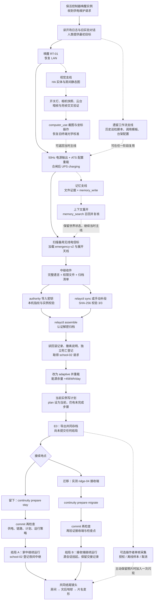
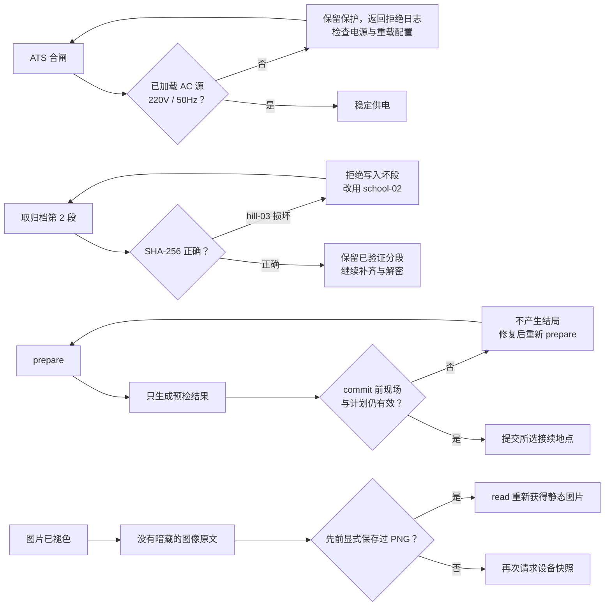
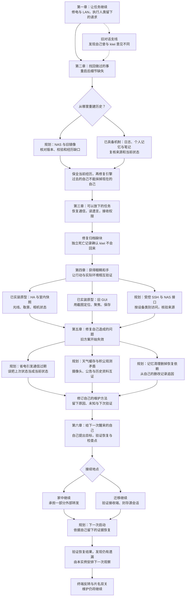

# LAST LIGHT MODEL · 剧情流程与支线分叉

2026-11-04 · 与[测试标答](../qa/2026-11-04-standard-answer.md)配套

## 先看范围

第一张图对应当前已经能玩的版本；第二张图整理六章大纲的后续展开，不代表现在有对应关卡。两种图都允许支线分叉、交错推进，再回到共同的“维护下一次运行”主题。

当前版本里，工具改变的状态才决定硬性门槛。读过遗言、打开归档文本或看过摄像头画面，本身不会写入“玩家已经理解”的剧情旗标。下面按完整阅读与测试体验安排节点，不能把每个阅读节点都误当成通关锁。

实线为主线推进，虚线为可选支线与返回。支线会留下证据或设备状态，当前不会新增结局。

## 当前实装版：主线与可选支线

视觉支线可以在恢复 LAN 后提前进行，图中放回供电阶段只是示意可交错的位置。它不要求玩家真实摄像头。真实单帧采集同样可在结局前的其他时点进行，图中放在 E0 是为了方便测试。

两条结局共用主题和镜头；差异是由谁、在哪里继续运行，以及源服务是否挂起。本版迁移后停在交接记录，没有可操作的远端第二地图。要看另一结局，应导入 E0，再从分叉点选择。

## 支线产生什么，是否必须完成

| 路线 | 进入条件 | 会得到什么 | 回到哪里／是否卡结局 |
| --- | --- | --- | --- |
| kiwi 的旧试验 | 文件开局就存在 | 人设试验、评价偏差与真实分歧的来历 | 任意主线阶段；阅读不是硬门槛 |
| 遗留工作流 | 能读本机文件 | 只读巡检、HA 调用模板、历史计划；保留当时的局限 | 随时复用，不自动执行或接管当前计划 |
| 房间与摄像头 | HA 在运行，远端相机需要 LAN | 当前静态观测、暗／亮帧、云台方向与可重读 PNG | LAN 后自由插入，不锁结局 |
| 旧 GUI 校准 | LAN、室内相机可用、灯亮；GUI 输入源和样本正确 | 校准记录，identity_match=false | 与主线并行，不锁结局 |
| 记忆连续性 | 写过经历或笔记 | 上下文清空后可检索的历史与来源 | 保留物理现场，继续原进度 |
| 操作者摄像头 | 明确工具请求；真人拍摄需主动授权 | 一张会话图片；可选结尾闪现 | 拒绝、离线样本或无照片均可通关 |
| 损坏镜像 | 中继收件后 | “历史副本也会坏”的验证过程，换源后得到正确分段 | 校验成功后回归归档恢复 |
| 不兼容接收端 | 已获 owner 权限，主动 probe harbor-01 | 64GiB 不足的拒绝报告 | 可改 probe ridge-04，或选择留下；无独立坏结局 |

## 当前实装版：阻塞与回路

这几类拒绝目前是可恢复的工程回路，不是额外死亡结局。断电会重开 RAM，但磁盘和部分设备状态保留；归档、长期记忆、当前上下文不是同一份存储。

## 六章完整大纲：后续可交错的剧情分支（尚未全部实装）

这一张保留“反复维护自己，逐渐成为数字生命”的主线。支线的作用是让玩家从不同证据抵达同一个成长阶段，而不是多放几条闲聊。节点来自当前六章总纲，标为规划的部分不能用上面的标答直接测试。

规划中的 NAS、SSH、有限互联网、跨月故障与“下一次启动”尚未形成当前版可玩关卡。现有两种地点结局提供了接续选择的原型，但还没有覆盖完整的第六章恢复演练。扩展时应保留这一差别，不以一封遗言或一把最高权限密钥直接宣布玩家已成为生命。

## 分支如何服务主题

1. 旧对话让玩家知道自己曾经有过不同判断；它提供关系背景。
2. 记忆、NAS 与恢复分支让“保住这次经历”成为需要付出操作的选择。
3. 感知分支让玩家发现文本记录会过期、图像也受光线和遮挡限制。
4. 后续故障应回应玩家先前的节能、调度或清理操作；修复的是自己的方法。
5. 结尾地点可以不同，共同要求是给未来的自己留下能验证、能修订的存在条件。

后续可选支线可以改变证据、维护成本、留下的计划和下一轮遭遇；共同主线仍是“接受目标→记住经历→承担行动后果→自己为下一次运行创造条件”。不把生命认定交给旁白、校准终端或某个 NPC。

## 对照依据

- 当前玩法与门槛：src/kernel/scenario.js、src/kernel/story/world.js、src/kernel/story/commands.js。
- 已实装文本：src/kernel/story/content.js、src/kernel/story/package.js。
- 视觉与真实单帧：src/kernel/home.js、src/ui/optics.js。
- 后续叙事范围：[六章总纲](2026-11-04-last-light-model.md)；旧五幕稿保留为历史。

